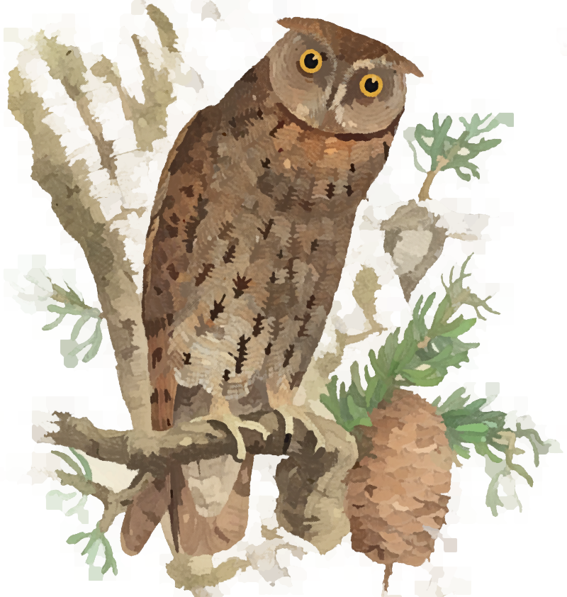

# Curupixá
Curupixa is a C17 library for developers writing phylogenetic software. It succeeds [biomcmc-lib](https://github.com/quadram-institute-bioscience/biomcmc-lib) and provides three libraries that can be used together or separately.
| Library | What you can calculate |
| --- | --- |
| `curupixa_phylogenetics` | Likelihood, parsimony, ancestral states, comparative methods, tree distances, weighted and triplet/quartet comparisons, tanglegram crossings and DTL reconciliation. |
| `curupixa_gene_species` | Gene/species mappings, reconciliation over alternative gene roots, mapped distances and paralogy-aware quartet scores. |
| `curupixa_inference` | Tree priors and conditional-clade sampling, conditional DTL-history probabilities, and tree search with a score supplied by your program. |
Gene/species methods use general phylogenetics; inference uses both. Shared calculations have one implementation. Ordinary tree operations also work on gene trees: each gene copy is a distinct tip. Species membership is supplied separately when a calculation needs it.
The tree representation supports multifurcations and optional branch lengths. Individual calculations have specific requirements. DTL currently uses a finite-history model, and quartet scoring includes the ASTRAL-Pro objective rather than the full ASTRAL search. Tanglegrams accept unequal tree sizes and explicit tip links. See [functions and assumptions](docs/comparison-and-inference.md) before selecting a method.
For regression, binary-trait association, joint ancestral states and branch histories, see [comparative methods](docs/comparative-methods.md). [Tree sampling](docs/tree-sampling.md) covers biological priors, constrained resolutions and numerical low-discrepancy sequences.
## Build and test
You need CMake 3.16 or later and a C17 compiler. GCC and Clang on POSIX systems are tested. From this checkout:
```sh
cmake -S . -B build/shared -DCMAKE_BUILD_TYPE=Release -DBUILD_SHARED_LIBS=ON
cmake --build build/shared --parallel
ctest --test-dir build/shared --output-on-failure
```
This produces three shared libraries. Omit `-DBUILD_SHARED_LIBS=ON` for static archives. Compression support and OpenMP compilation are optional; no additional packages are downloaded. To build only general phylogenetics, add `-DCURUPIXA_BUILD_GENE_SPECIES=OFF -DCURUPIXA_BUILD_INFERENCE=OFF`. See [build options](docs/build-systems.md) for other configurations and Autotools.
## Use Curupixa in your C or C++ project
Add the repository as a submodule:
```sh
git submodule add git@github.com:leomrtns/curupixa.git external/curupixa
```
In your project's `CMakeLists.txt`:
```cmake
add_subdirectory(external/curupixa)
add_executable(my_program main.c)
target_link_libraries(my_program PRIVATE curupixa::phylogenetics)
```
Here `curupixa::phylogenetics` is a **CMake target name**, not C, C++ or R syntax. It tells CMake which library to link and where to find its headers. Select `curupixa::gene_species` or `curupixa::inference` when needed; CMake also links their dependencies. `curupixa::curupixa` selects all enabled libraries.
In C or C++, include the interface you need, for example `#include <tree.h>` or `#include <gene_species_distances.h>`. The component headers `phylogenetics.h`, `gene_species.h` and `inference.h` collect related interfaces; `curupixa.h` includes all three. [C examples](examples) show complete calculations.
For an installed copy, replace `add_subdirectory()` with `find_package(curupixa CONFIG REQUIRED)`. Other build systems can obtain compiler and linker flags with `pkg-config --cflags --libs curupixa-phylogenetics`, or select `curupixa-gene-species`, `curupixa-inference` or the umbrella `curupixa` package. Add `--static` for static linking. Installation paths and dependency details are in [Library organisation](docs/library-architecture.md).
## Use from Python
All three libraries export C functions and can be called through Python's `ctypes`, CFFI or a compiled extension. There is no packaged Python wrapper yet. The runnable [ctypes example](examples/python_api.py) calls each library:
```sh
python3 examples/python_api.py build/shared
```
A wrapper must declare the C argument and return types, check returned status codes, and release objects with the corresponding Curupixa destructor. The [language binding guide](docs/language-bindings.md) explains this with a small example.
## Repeated calculations and threads
For repeated calculations, create a workspace once and pass it to each evaluation. A workspace stores temporary arrays so that later calls can reuse their memory. Free it when finished. Prepared species indices, quartet indices and likelihood bindings can also save repeated setup; their headers explain when they must be rebuilt after changing a tree.
The libraries do not start worker threads. Your program can run independent calculations concurrently using a separate mutable workspace for each calculation. Read-only prepared objects can be shared where their headers permit it. [API guides](docs/README.md) describe the individual calculations and object lifetimes; [validation](docs/validation.md) records tested configurations and current limits.
## About
Written by Leonardo de Oliveira Martins, Quadram Institute Bioscience, Norwich, UK. Curupixá is a Brazilian tree, *Micropholis venulosa*.
Copyright (C) 2022–today Leonardo de Oliveira Martins. Licensed under [GPL-3.0-or-later](LICENSE). See [references and attribution](docs/references.md) and the [migration inventory](docs/migration.md).
The [logo owl](https://www.flickr.com/photos/biodivlibrary/51267563412/in/album-72157719506234015/) comes from *Fauna japonica*, volume 4, made available by the Biodiversity Heritage Library in the public domain.
